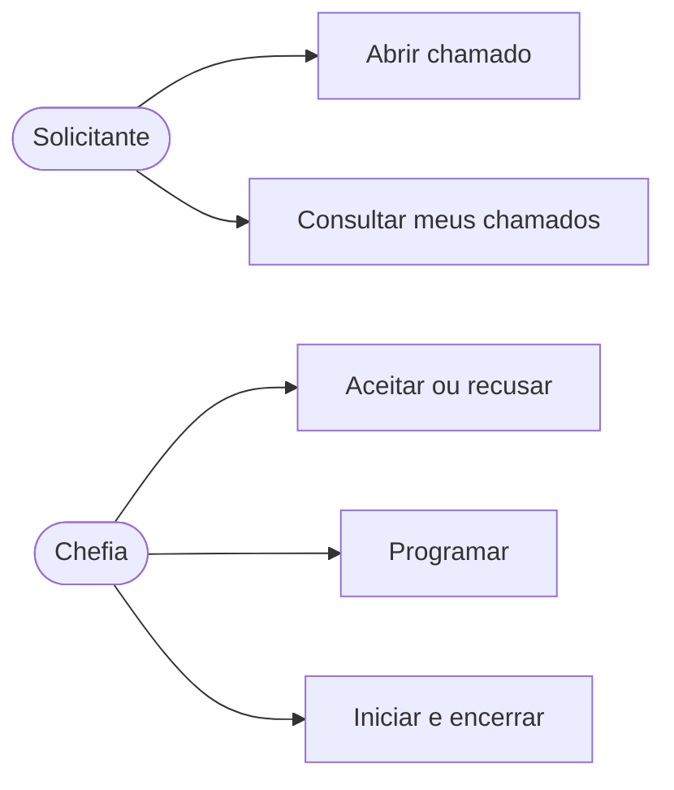
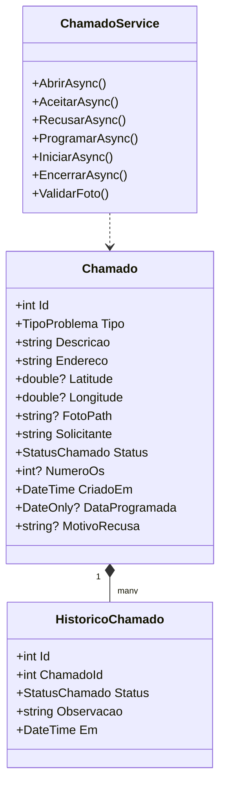
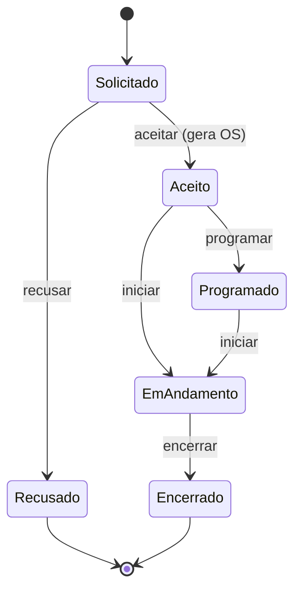
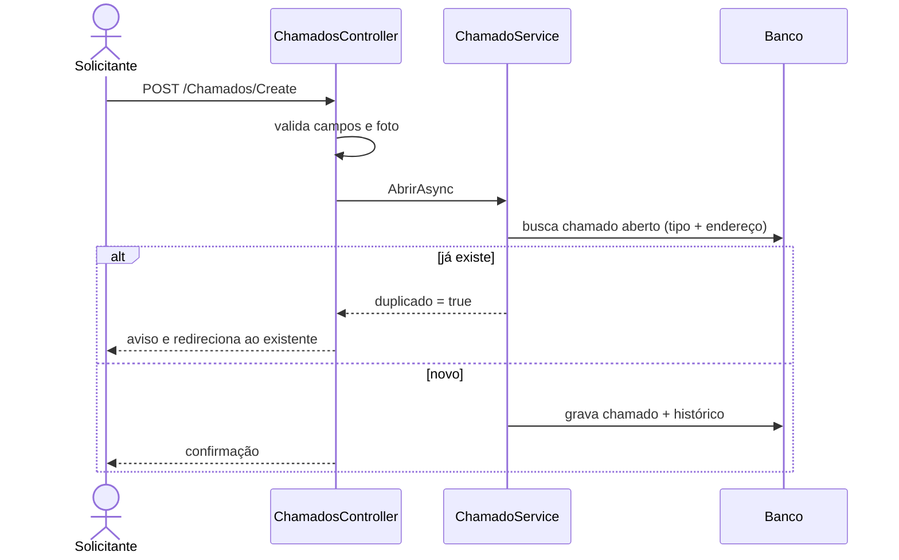

# Requisitos e modelagem

## Problema

Solicitações de manutenção chegam de forma informal (mensagens soltas). Pedidos se perdem, não há número nem histórico, e o solicitante não sabe o que aconteceu, então pede de novo e gera duplicidade.

## Requisitos funcionais

| ID | Requisito |
|---|---|
| RF01 | O solicitante abre um chamado com nome, tipo, endereço, descrição, coordenadas (opcional) e foto (opcional). |
| RF02 | O sistema impede chamado duplicado: mesmo tipo e mesmo endereço com chamado ainda aberto retorna o existente. |
| RF03 | A chefia aceita o chamado; o sistema gera número de OS sequencial e único. |
| RF04 | A chefia pode recusar informando motivo obrigatório. |
| RF05 | A chefia programa uma data, inicia e encerra o serviço, nessa ordem. |
| RF06 | O solicitante consulta seus chamados e vê status, número da OS e data programada. |
| RF07 | Cada mudança de status fica no histórico do chamado. |

## Requisitos não funcionais

| ID | Requisito |
|---|---|
| RNF01 | Foto aceita apenas JPG ou PNG, até 5 MB. |
| RNF02 | Aplicação roda localmente sem serviços pagos. |
| RNF03 | Arquitetura em camadas MVC, com regras de negócio fora dos controllers. |
| RNF04 | Interface responsiva (Bootstrap) e mensagens de erro claras. |
| RNF05 | Formulários protegidos por token antifalsificação. |

## Regras de negócio

- Só é atendido o que tem número de OS.
- Transições válidas: Solicitado → Aceito ou Recusado; Aceito → Programado ou Em andamento; Programado → Em andamento; Em andamento → Encerrado.
- Depois de Encerrado ou Recusado, o chamado deixa de contar para a verificação de duplicidade.

## Casos de uso

## Diagrama de classes

## Diagrama de estados

## Diagrama de sequência: abrir chamado

## Interface (IHC)

Princípios aplicados: interface simples e consistente (mesmo menu em todas as telas), feedback imediato (alertas de sucesso, aviso e erro), validação de formulário com mensagem junto ao campo, ações da chefia separadas por etapa e confirmação visual do status.

Mensagens principais:

| Situação | Mensagem |
|---|---|
| Chamado enviado | "Chamado enviado. A chefia vai analisar." |
| Duplicado com OS | "Já existe a OS N para este problema neste local. Acompanhe por ela." |
| Duplicado sem OS | "Já existe um chamado em análise para este problema neste local." |
| Foto inválida | "Use foto JPG ou PNG." / "Foto maior que 5 MB." |
| Transição inválida | "Transição inválida a partir de {status}." |
